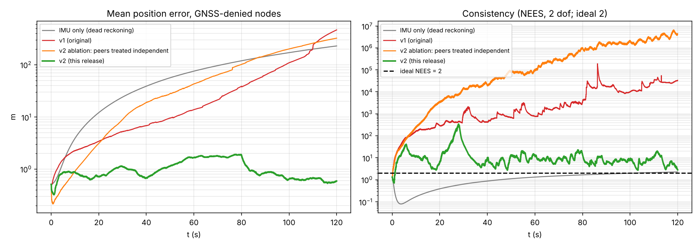
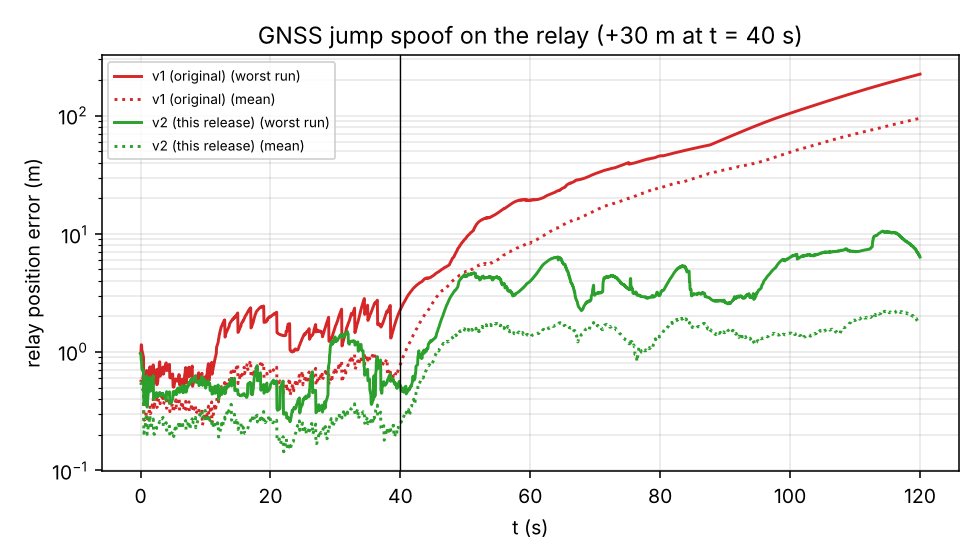
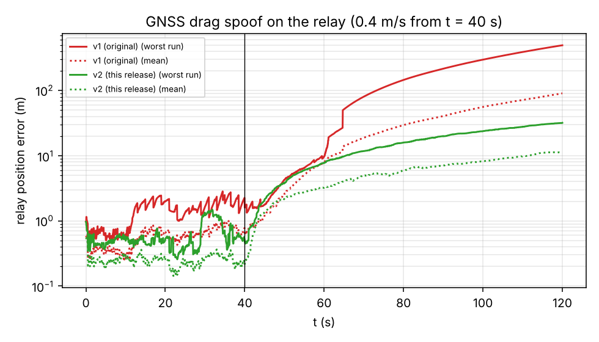

# Results (auto-generated by `scripts/make_report.py`)

All numbers: mean ± 95 % CI over independent random scenarios (seeds 200+, never used for tuning; seeds 0-9 were the development set). 10 nodes, 120 s, tactical nodes 2-9 scored after a 10 s warm-up. Simulator deliberately differs from the filter's model (see `aethernet/sim/scenario.py`).

## Nominal mission (anchor + relay with 40 s GNSS outage + 8 GNSS-denied nodes)

| Algorithm | RMSE (m) | p95 (m) | max (m) | relative RMSE (m) | median NEES | % NEES > 13.8 | CPU s / run |
|---|---|---|---|---|---|---|---|
| IMU only (dead reckoning) | 129.85 ± 8.38 | 274.97 ± 20.89 | 413.3 ± 33.1 | 175.74 ± 11.57 | 0.86 ± 0.16 | 0.0% | 0.9 ± 0.0 |
| v1 (original) | 198.57 ± 123.43 | 250.13 ± 189.62 | 1767.8 ± 1195.0 | 273.25 ± 172.57 | 474.32 ± 138.01 | 90.9% | 4.2 ± 0.2 |
| v2 (this release) | 1.52 ± 0.34 | 3.23 ± 0.65 | 8.0 ± 2.8 | 0.98 ± 0.18 | 1.40 ± 0.20 | 6.6% | 6.0 ± 0.2 |
| v2 ablation: peers treated independent | 168.15 ± 83.55 | 241.65 ± 79.06 | 825.3 ± 592.7 | 112.66 ± 116.62 | 79008.67 ± 49982.78 | 98.7% | 7.9 ± 0.4 |
| v2 ablation: marginal CI | 13.93 ± 15.72 | 15.52 ± 5.21 | 108.7 ± 159.8 | 12.83 ± 22.61 | 47.33 ± 67.60 | 39.9% | 5.8 ± 0.2 |
| v2 ablation: Schmidt frozen bias | 1.68 ± 0.38 | 3.53 ± 0.70 | 9.0 ± 3.1 | 1.09 ± 0.20 | 1.39 ± 0.18 | 7.1% | 6.0 ± 0.2 |
| v2 ablation: 2-D ranges (no altitude) | 5.67 ± 0.72 | 11.53 ± 1.62 | 25.2 ± 4.1 | 3.58 ± 0.40 | 98.51 ± 25.89 | 79.3% | 5.8 ± 0.2 |
| v2 ablation: no latency compensation | 1.51 ± 0.34 | 3.18 ± 0.64 | 7.9 ± 2.9 | 0.99 ± 0.19 | 1.39 ± 0.18 | 6.5% | 5.6 ± 0.2 |

*Relative RMSE = pairwise inter-node distance error (what the swarm itself needs). % NEES > 13.8 should be ~0.1 % for a consistent filter.*

## GNSS jump spoof on the relay (+30 m at t = 40 s)

| Algorithm | relay RMSE (m) | relay max err (m) | tactical RMSE (m) | tactical max (m) |
|---|---|---|---|---|
| v1 (original) | 35.80 ± 13.68 | 96.2 ± 41.0 | 110.10 ± 81.27 | 836.1 ± 629.4 |
| v2 (this release) | 1.64 ± 0.54 | 4.6 ± 1.5 | 2.05 ± 0.60 | 10.8 ± 5.2 |

## GNSS drag spoof on the relay (0.4 m/s from t = 40 s)

| Algorithm | relay RMSE (m) | relay max err (m) | tactical RMSE (m) | tactical max (m) |
|---|---|---|---|---|
| v1 (original) | 37.27 ± 35.33 | 90.6 ± 89.8 | 483.47 ± 543.85 | 5348.0 ± 7686.4 |
| v2 (this release) | 5.96 ± 4.13 | 12.9 ± 8.2 | 3.85 ± 1.98 | 16.8 ± 9.0 |

## 3 s IMU stall on nodes 3-5 at t = 60 s

| Algorithm | RMSE (m) | p95 (m) | max (m) | relative RMSE (m) | median NEES | % NEES > 13.8 |
|---|---|---|---|---|---|---|
| v1 (original) | 353.34 ± 215.04 | 705.33 ± 433.06 | 2560.7 ± 1697.3 | 451.12 ± 280.67 | 593.77 ± 188.64 | 92.0% |
| v2 (this release) | 2.35 ± 0.96 | 4.74 ± 2.08 | 15.5 ± 5.0 | 1.46 ± 0.42 | 1.61 ± 0.38 | 10.6% |

## No fixed anchor; relay GNSS only for the first 40 s

| Algorithm | RMSE (m) | p95 (m) | max (m) | relative RMSE (m) | median NEES | % NEES > 13.8 |
|---|---|---|---|---|---|---|
| IMU only (dead reckoning) | 125.45 ± 11.09 | 264.06 ± 29.73 | 404.7 ± 52.5 | 167.22 ± 15.98 | 0.78 ± 0.23 | 0.0% |
| v1 (original) | 67.54 ± 61.75 | 86.05 ± 57.72 | 600.0 ± 872.9 | 73.67 ± 94.20 | 579.99 ± 273.12 | 87.6% |
| v2 (this release) | 21.25 ± 3.80 | 44.76 ± 8.66 | 55.5 ± 9.9 | 3.64 ± 0.28 | 6.09 ± 1.65 | 35.4% |

